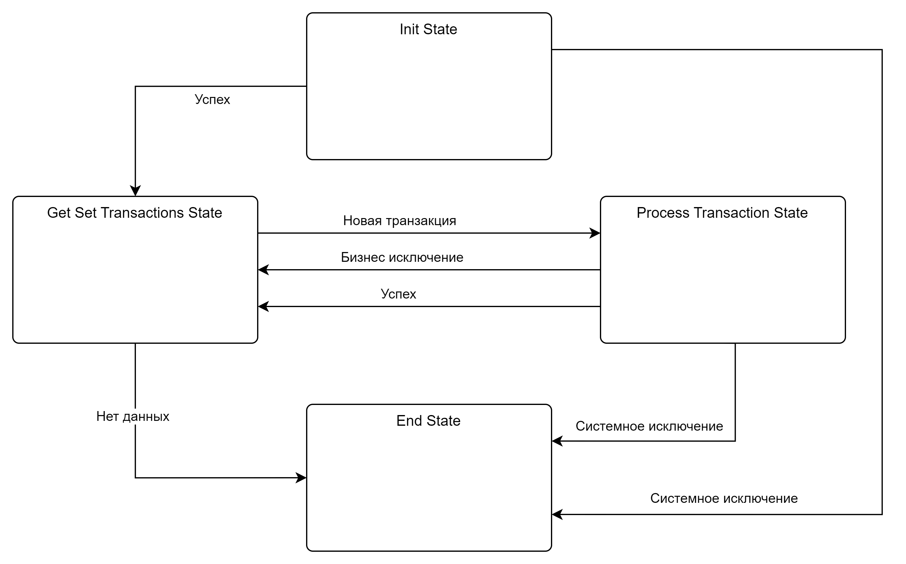
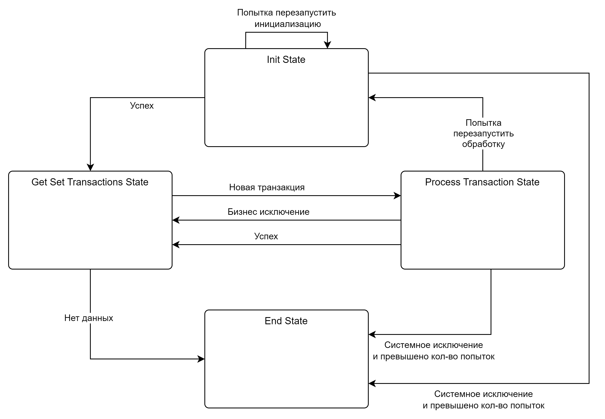
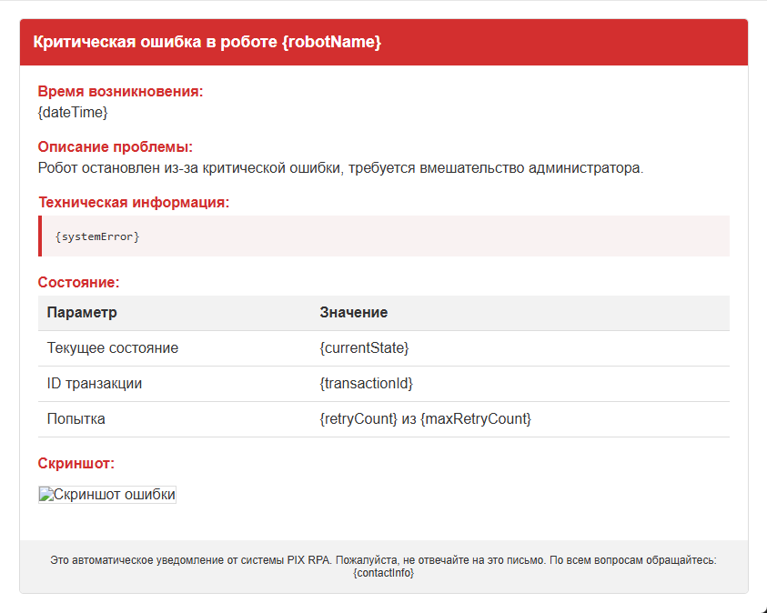
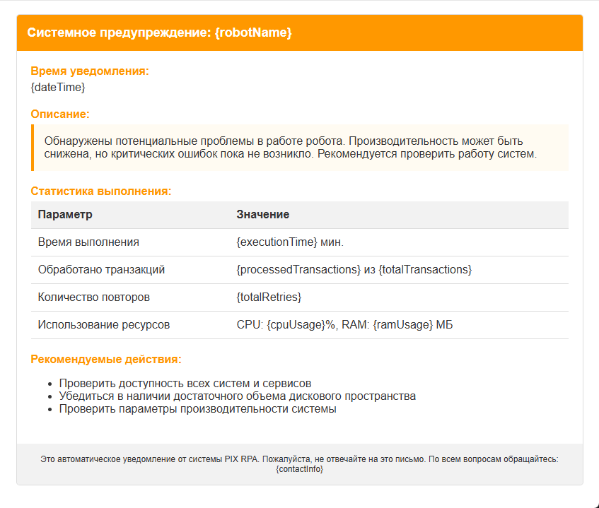
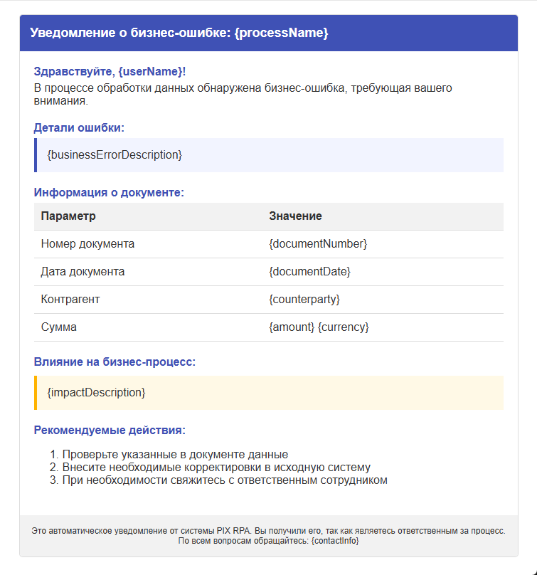

# Шаблоны для роботов PIX RPA

## 📑 Содержание
- [Описание](#описание)
- [Базовые понятия](#базовые-понятия)
- [Структура репозитория](#структура-репозитория)
- [Типы шаблонов](#типы-шаблонов)
- [Структура названия шаблонов](#структура-названия-шаблонов)
- [Руководство по выбору шаблона](#руководство-по-выбору-шаблона)
- [Схемы работы шаблонов](#схемы-работы-шаблонов)
- [Часто задаваемые вопросы](#часто-задаваемые-вопросы)
- [Примеры уведомлений](#примеры-уведомлений)
- [Глоссарий](#глоссарий)

## 📋 Описание

Данный репозиторий содержит набор готовых шаблонов для разработки роботов на платформе PIX RPA. Шаблоны предназначены для ускорения разработки, обеспечения стандартизации кода и повышения надежности решений.

Каждый шаблон предоставляет структурированный подход к автоматизации бизнес-процессов и включает встроенные механизмы для обработки исключительных ситуаций, логирования и уведомлений.

> 📄 **Подробная документация по транзакционным шаблонам доступна в [transaction/TEMPLATES.md](transaction/TEMPLATES.md)**

## 🔍 Базовые понятия

Перед изучением шаблонов полезно ознакомиться с ключевыми понятиями:

* **RPA (Robotic Process Automation)** — технология автоматизации бизнес-процессов с помощью программных роботов.

* **Робот** — программа, выполняющая последовательность действий для автоматизации процесса.

* **Состояние (State)** — отдельный этап в цикле работы робота с определенной задачей (например, инициализация или обработка данных).

* **Транзакция** — элементарная единица данных, которую обрабатывает робот (например, строка таблицы, сообщение из очереди или файл).

* **Оркестратор (Мастер)** — центральная система управления роботами, где настраиваются и запускаются роботы, а также хранятся очереди задач.

* **Очередь (Queue)** — список задач/транзакций для обработки роботом.

* **Конфигурация** — набор настроек, определяющих поведение робота.

## 📂 Структура репозитория

Репозиторий организован по следующим принципам:

```
pix-templates/
│
├── transaction/               # Транзакционные шаблоны (4 состояния)
│   ├── master-config/         # Конфигурация из оркестратора
│   │   ├── queue/             # Работа с очередями (RQ, Q2Q)
│   │   ├── file/              # Работа с файлами (F, F2Q)
│   │   ├── mail/              # Работа с письмами (M, M2Q)
│   │   ├── list/              # Работа со списками (LT, LT2Q)
│   │   └── row/               # Работа с таблицами (R, R2Q)
│   │
│   ├── excel-config/          # Конфигурация из Excel-файла
│   │   ├── kafka/             # Работа с Kafka (K, K2F, F2K)
│   │   ├── rabbitmq/          # Работа с RabbitMQ (RMQ)
│   │   └── ...                # Аналогичные шаблоны для файлов, писем и др.
│   │
│   └── TEMPLATES.md           # Подробное описание всех транзакционных шаблонов
│
├── simple/                    # Нетранзакционные шаблоны (3 состояния)
│   ├── master-config/         # Шаблон с конфигурацией из оркестратора
│   └── excel-config/          # Шаблон с конфигурацией из Excel-файла
│
└── assets/                    # Ресурсы для документации
```

> **master-config** — конфигурация робота хранится в оркестраторе (PIX Master)  
> **excel-config** — конфигурация робота хранится в Excel-файле

Каждый шаблон реализует определённую комбинацию:
1. **Типа конфигурации** (master или excel)
2. **Источника данных** (очередь, файлы, почта, Kafka и т.д.)
3. **Целевого хранилища** (куда записывать результаты)

Примеры комбинаций источников и назначений:
- RQ - Чтение только из очереди
- Q2Q - Чтение из очереди и запись в другую очередь
- F2Q - Чтение из файлов и запись в очередь
- LT2Q - Чтение из списка объектов и запись в очередь
- R2Q - Чтение из таблицы и запись в очередь
- M2F - Чтение из почты и запись в файлы

## 🔄 Типы шаблонов

В репозитории представлены два типа шаблонов:

### 1. Транзакционные шаблоны (4 состояния)

Транзакционные шаблоны предназначены для обработки наборов данных, где каждый элемент данных (транзакция) проходит одинаковую последовательность действий.

**Подробная документация по транзакционным шаблонам:** [Транзакционные шаблоны](transaction/TEMPLATES.md)

**Особенности:**
- Обработка множества элементов данных (транзакций) в цикле
- Работа с очередями, файлами, почтой, списками
- Восстановление после сбоев
- Обработка ошибок на уровне отдельных транзакций

**Структура имени:** `T-{ТИП Шаблона}-{ТИП Транзакции}-{ТИП Оповещения}`

### 2. Простые шаблоны (Simple)

Шаблоны с 3 состояниями (Init, Processing, End), предназначенные для выполнения одиночных операций без обработки наборов данных.

**Подробная документация по простым шаблонам:** [Простые шаблоны](simple/TEMPLATES.md)

**Простыми словами**: Эти шаблоны подходят, когда нужно выполнить одно действие (например, сформировать отчет или отправить уведомление).

**Особенности:**
- Выполнение однократных операций
- Запуск по расписанию, вручную или через API
- Простая логика без обработки множества элементов
- Подходят для автоматизации одиночных бизнес-процессов

**Структура имени:** `S-{ТИП Оповещения}`

## 🔤 Структура названия шаблонов

### Полная структура имен шаблонов

```
Транзакционные:  T-{ТИП Шаблона}-{ТИП Транзакции}-{ТИП Оповещения}
Простые:         S-{ТИП Оповещения}
```

Где:
- **T/S** - тип шаблона (T - Транзакционный, S - Простой)

### Компоненты для транзакционных шаблонов (T)

#### Тип шаблона

| Обозначение | Описание |
|-------------|----------|
| **SM** | **S**tate **M**achine - шаблон на основе конечного автомата с 4 основными состояниями |
| **R** | **R**etry - шаблон с механизмами повторения операций при сбоях |
| **UI** | **U**ser **I**nterface - шаблон для работы с пользовательским интерфейсом |

> 💡 **Что такое State Machine?**  
> Конечный автомат — это модель, которая описывает последовательность состояний и переходов между ними. Например, робот может находиться в состоянии "инициализация", потом перейти в состояние "обработка данных" и т.д.

#### Тип транзакции (источник и назначение)

Тип транзакции включает информацию как об источнике данных, так и о назначении результатов (если применимо):

```
{ИСТОЧНИК}[2{НАЗНАЧЕНИЕ}]
```

Например:
- **RQ** - чтение только из очереди
- **F2Q** - чтение из файла и запись в очередь
- **M2F** - чтение из почты и запись в файл

**Обозначения источников и назначений:**

| Обозначение | Описание |
|-------------|----------|
| **Q** | **Q**ueue - очередь оркестратора |
| **K** | **K**afka - система обмена сообщениями Apache Kafka |
| **RMQ** | **R**abbit**MQ** - система обмена сообщениями RabbitMQ |
| **F** | **F**ile - файлы из FTP или сетевой папки |
| **M** | **M**ail - электронные письма |
| **LT** | **L**ist<**T**> - списки объектов определенного типа |
| **R** | **R**ow - строки таблицы данных |
| **DB** | **D**ata**B**ase - реляционная база данных |

### Тип оповещения (общий для всех шаблонов)

| Обозначение | Описание |
|-------------|----------|
| **A** | **A**dmin - оповещение администраторов |
| **E** | **E**xchange - оповещение через почтовый сервер Microsoft Exchange |
| **S** | **S**MTP - оповещение через стандартный почтовый протокол |
| **U** | **U**ser - оповещение пользователей |

### Примеры названий шаблонов

#### Транзакционные шаблоны
- **T-SMRUI-RQ-EAU** - транзакционный шаблон с автоматом, повторами, работой с интерфейсом, чтением очереди, оповещениями через Exchange для администраторов и пользователей
- **T-SMR-F2Q-EAU** - транзакционный шаблон с автоматом, повторами, чтением из файла и записью в очередь, с оповещениями через Exchange

#### Простые шаблоны
- **S-EAU** - простой шаблон с оповещениями через Exchange для администраторов и пользователей
- **S-S** - простой шаблон с оповещениями через SMTP

## 🔍 Руководство по выбору шаблона

### Шаг 1: Определение типа процесса

**Транзакционный процесс (transaction)**
- Обработка множества элементов (транзакций)
- Работа с очередями, файлами, письмами
- Необходимость потоковой обработки данных

**Нетранзакционный процесс (simple)**
- Единичная операция
- Одноразовая или периодическая задача
- Отсутствие необходимости в обработке множества элементов

> 💡 **Пример для понимания**  
> Если нужно обработать 100 заказов — используйте транзакционный шаблон.  
> Если нужно сформировать один отчет — используйте простой шаблон.

### Шаг 2: Выбор шаблона в зависимости от требований

#### Для транзакционных процессов:

1. **Источник и назначение данных**: откуда брать данные и куда отправлять результаты (RQ, Q2Q, F2Q, M2Q и т.д.)
2. **UI-компоненты**: нужно ли взаимодействовать с интерфейсом программ (SMRUI)
3. **Отказоустойчивость**: нужны ли автоматические повторы при ошибках (SMR)
4. **Конфигурация**: где хранить настройки (master-config или excel-config)

#### Для нетранзакционных процессов:

1. **Конфигурация**: где хранить настройки (master-config или excel-config)

### Матрица выбора шаблона

| Сценарий использования | Рекомендуемый шаблон |
|------------------------|----------------------|
| Автономная обработка очереди оркестратора с использованием UI | transaction/master-config/queue/read-queue/T-SMRUI-RQ-EAU |
| Цепочка роботов без UI через очереди оркестратора | transaction/master-config/queue/read-write-queue/T-SMR-Q2Q-EAU |
| Обработка файлов и запись результатов в очередь | transaction/master-config/file/file-to-queue/T-SMR-F2Q-EAU |
| Чтение писем и запись данных в очередь с UI | transaction/master-config/mail/mail-to-queue/T-SMRUI-M2Q-EAU |
| Обработка списка объектов и запись в очередь | transaction/master-config/list/list-to-queue/T-SMR-LT2Q-EAU |
| Обработка таблицы и запись в очередь | transaction/master-config/row/row-to-queue/T-SM-R2Q-EAU |
| Обработка событий из Kafka и сохранение в файлы | transaction/excel-config/kafka/kafka-to-file/T-SMR-K2F-EAU |
| Одиночная операция (настройки в оркестраторе) | simple/master-config/S-EAU |
| Одиночная операция (настройки в Excel) | simple/excel-config/S-EAU |

> 📄 **Подробное описание всех типов транзакционных шаблонов смотрите в [transaction/TEMPLATES.md](transaction/TEMPLATES.md)**

## 📊 Схемы работы шаблонов

### Транзакционные шаблоны (4 состояния)



Транзакционные шаблоны включают четыре основных состояния:

1. **Init State** - подготовка робота к работе (загрузка настроек, подключение к системам)
2. **Get Set Transactions State** - получение списка элементов для обработки
3. **Process Transaction State** - обработка каждого элемента из списка
4. **End State** - завершение работы, освобождение ресурсов

#### Схема State Machine с механизмом повторов (SMR)



Шаблоны с механизмом повторов (SMR) расширяют базовую схему SM, добавляя:

- Автоматические попытки повторной инициализации при сбоях
- Механизм повторного запуска обработки транзакций в случае системных ошибок
- Контроль количества попыток для предотвращения бесконечных циклов
- Разделение ошибок на бизнес-исключения (влияют только на текущую транзакцию) и системные исключения (могут привести к перезапуску состояния)

### Простые шаблоны (3 состояния)

```
┌─────────────┐       ┌──────────────┐       ┌─────────────┐
│  Init State │ ───►  │ Process State│ ───►  │  End State  │
└─────────────┘       └──────────────┘       └─────────────┘
```

Простые шаблоны включают три основных состояния:

1. **Init State** - подготовка робота к работе (загрузка настроек, подключение к системам)
2. **Process State** - выполнение основной операции
3. **End State** - завершение работы, освобождение ресурсов

## ❓ Часто задаваемые вопросы

<details>
<summary><b>Когда использовать шаблоны с UI?</b></summary>
Шаблоны с UI (содержат в названии "UI") следует использовать, когда робот должен работать с графическим интерфейсом программ, например, заполнять формы, нажимать кнопки, выбирать данные в таблицах. Такие шаблоны автоматически делают снимки экрана при ошибках, что помогает в отладке.
</details>

<details>
<summary><b>Когда нужны шаблоны с механизмом повторов?</b></summary>
Шаблоны с повторами (содержат в названии "R") рекомендуются для важных процессов, где нужно, чтобы робот автоматически пытался повторно выполнить действие при возникновении ошибки. Например, если при отправке данных возникла временная проблема с сетью, робот сделает несколько повторных попыток.
</details>

<details>
<summary><b>Чем отличаются master-config и excel-config?</b></summary>

**master-config** подходит для:
- Рабочей среды (продакшн)
- Централизованного управления
- Защиты чувствительных данных

**excel-config** рекомендуется для:
- Разработки и тестирования
- Быстрого создания прототипов
- Запуска без доступа к оркестратору
</details>

<details>
<summary><b>Как настроить уведомления?</b></summary>
Все шаблоны поддерживают настройку уведомлений через параметры конфигурации. Вы можете указать:
- Кому отправлять уведомления
- Шаблоны текста сообщений
- При каких условиях отправлять уведомления (успех, ошибка, предупреждение)
</details>

## 📧 Примеры уведомлений

В шаблонах PIX RPA используется система уведомлений, позволяющая информировать администраторов и пользователей о важных событиях в работе роботов.

### Типы уведомлений

| Тип | Описание | Получатели |
|-----|----------|------------|
| **Критическая ошибка** | Уведомление о серьезной проблеме, требующей немедленного вмешательства | Администраторы |
| **Бизнес-ошибка** | Уведомление о проблеме с бизнес-данными или логикой | Администраторы, бизнес-пользователи |
| **Системное предупреждение** | Информация о возможных проблемах | Администраторы |

### Примеры HTML-шаблонов уведомлений

#### Уведомление для администратора с скриншотом (критическая ошибка)



[HTML-шаблон критической ошибки](notifications/critical-error.html)

#### Уведомление для администратора без скриншота (системное предупреждение)



[HTML-шаблон системного предупреждения](notifications/system-warning.html)

#### Уведомление для бизнес-пользователя (бизнес-ошибка)



[HTML-шаблон бизнес-ошибки](notifications/business-error.html)

#### Дополнительные шаблоны уведомлений

В папке [notifications](notifications/) доступны дополнительные шаблоны для различных сценариев:

| Шаблон | Описание |
|--------|----------|
| [success.html](notifications/success.html) | Уведомление об успешном выполнении задачи |
| [error.html](notifications/error.html) | Уведомление об ошибке выполнения робота |
| [report.html](notifications/report.html) | Отчет о выполнении без вложений |
| [report-with-attachment.html](notifications/report-with-attachment.html) | Отчет о выполнении с вложениями |

## 📘 Глоссарий

| Термин | Определение |
|--------|-------------|
| **RPA** | Robotic Process Automation - технология автоматизации бизнес-процессов с помощью программных роботов |
| **Оркестратор (Мастер)** | Центральная система управления роботами, позволяющая настраивать параметры, планировать запуски и отслеживать выполнение |
| **Транзакция** | Элементарная единица данных, обрабатываемая роботом (запись, документ, сообщение и т.д.) |
| **Очередь** | Структура для хранения задач и передачи их между роботами |
| **Брокер сообщений** | Система, обеспечивающая обмен сообщениями между программами (например, Kafka, RabbitMQ) |
| **State Machine** | Конечный автомат - модель робота, основанная на переходах между состояниями |
| **Retry** | Механизм повторной попытки выполнения действия при возникновении ошибки |
| **UI-взаимодействие** | Работа робота с графическим интерфейсом программ |
| **API** | Application Programming Interface - интерфейс для взаимодействия между программами |